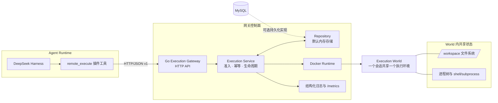

# Agent Execution Gateway v1

面向 Agent Runtime 的远程执行与沙箱治理（Remote Execution & Sandbox Governance）。

本项目是一个独立的 Go 执行平面，用于补充 Agent Runtime 的能力。它把 **Execution World（执行世界）** 建模为文件系统与进程共享的一致性边界，并在此基础上提供生命周期管理、幂等、有界输出、资源限制、租约与崩溃恢复能力。

## 架构



文件系统操作和进程执行都路由到同一个 Execution World，因此进程可以访问 Agent 先前写入 `/workspace` 的文件。默认启动使用内存 repository；MySQL repository 已提供实现，但默认二进制尚未接入它。

核心抽象是 **Execution World**，而不是"每次请求一个容器"。同一个 world 内的文件系统与进程调用，看到的是同一份可变工作区与进程命名空间。

## V1 范围

- Execution World 生命周期管理
- Docker 运行时
- 基于 argv 的进程执行
- 进程组清理：TERM -> 宽限期 -> KILL
- 命令超时
- 有界 stdout/stderr 缓冲 + 基于 offset 的读取
- 按租户 + 幂等键的幂等
- `/workspace` 下的语义化文件系统读/写/编辑
- Redis 租约管理器
- 过期回收（expiry reconciliation）
- MySQL schema + repository
- HTTP API
- Harness adapter 契约
- **可加载的 Harness 插件**（`remote_execute` 工具，含重试 + 熔断）
- **结构化 JSON 日志**（execution_started / execution_finished / world 生命周期）
- **`/metrics` 指标端点**（Prometheus 文本格式，零依赖）
- 单元/集成风格测试

可运行的 V1 二进制默认使用内存 repository，保证 demo 零外部依赖；`internal/repository/mysql.go` 与 `migrations/001_init.sql` 提供了面向下一步集成验证的 MySQL 持久化实现。

V1 刻意不宣称生产级隔离能力。它是一个用于演示执行平面架构的技术项目。

## 运行

环境要求：Go 1.23+、Docker。

```bash
docker compose up -d mysql redis
go test ./...
go run ./cmd/gateway
```

网关默认监听 `:8080`。

创建执行世界：

```bash
curl -X POST http://localhost:8080/v1/worlds \
  -H 'Content-Type: application/json' \
  -H 'X-Tenant-ID: demo' \
  -d '{"session_id":"s1","resource":{"cpu":1,"memory_mb":256,"pids":64,"disk_mb":512,"timeout_sec":60}}'
```

启动进程：

```bash
curl -X POST http://localhost:8080/v1/worlds/WORLD_ID/executions \
  -H 'Content-Type: application/json' \
  -H 'X-Tenant-ID: demo' \
  -H 'Idempotency-Key: exec-001' \
  -d '{"argv":["sh","-lc","echo hello; sleep 1; echo done"],"workdir":"/workspace","timeout_sec":10,"output_limit":1048576}'
```

查询状态 / 读取输出：

```bash
curl http://localhost:8080/v1/executions/EXEC_ID
curl 'http://localhost:8080/v1/processes/PROCESS_ID/output?stream=stdout&offset=0&limit=65536'
```

写入 / 读取文件：

```bash
curl -X PUT http://localhost:8080/v1/worlds/WORLD_ID/fs/write \
  -H 'Content-Type: application/json' \
  -d '{"path":"/workspace/a.txt","content":"hello\n"}'

curl 'http://localhost:8080/v1/worlds/WORLD_ID/fs/read?path=/workspace/a.txt'
```

指标：

```bash
curl http://localhost:8080/metrics
```

每次执行都会以结构化 JSON 的形式输出到 stdout（`execution_started` / `execution_finished`，包含 duration、退出码与终止原因）。

## DeepSeek Harness 插件

`harness-adapter/` 目录包含一个可加载的 Harness 插件，把 Agent 的工具执行路由到这个网关：

```bash
cd harness-adapter
npm install
npm run build
dsh plugin add <路径或包名>
```

它注册了一个工具 `remote_execute`（参数：command / timeout_sec / workdir），具备以下能力：

- 按会话懒创建 Execution World（Docker，无网络，带资源限制）
- 通过网关执行 `sh -lc <command>`，并携带幂等键
- 对可重试的网关故障（网络 / 5xx / 超时）**重试**：指数退避 + 抖动，并复用同一个幂等键（绝不重复执行已启动的命令）
- 连续失败后打开**熔断器**，快速失败并给出明确错误
- 把 harness 的取消信号转发给进行中的请求与轮询

通过插件配置或环境变量设置：`DSH_EXECUTOR_URL`（默认 `http://127.0.0.1:8080`）、`DSH_EXECUTOR_TENANT`（默认 `dsh-default`）、`sessionId`（默认 `dsh-session`）。详见 `harness-adapter/README.md`。

## 与 DeepSeek Harness 的关系

adapter 在概念上遵循 harness 的能力 seam：

- `ctx.fs` -> 文件系统网关（FileSystemGateway）
- `ctx.subprocess` -> 执行端点
- `ctx.shell` -> subprocess 的上层消费者

远程 Provider 必须共享同一个 `ExecutionWorld`：不要为文件系统和 subprocess 分别创建容器。本项目定位是网关/运行时实现，而不是对 Harness 的 fork。

